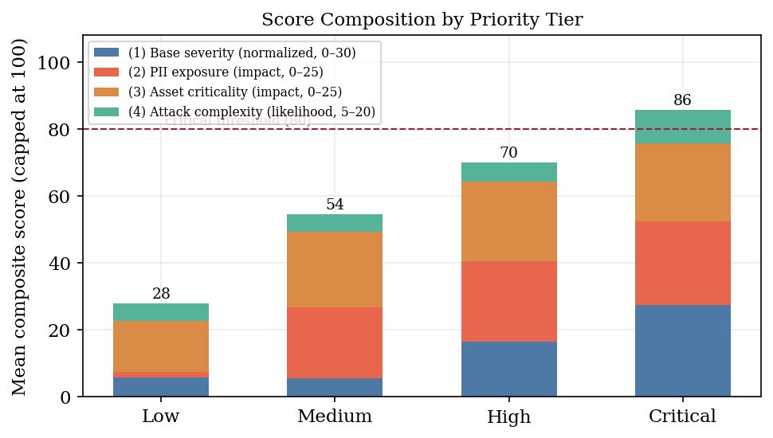
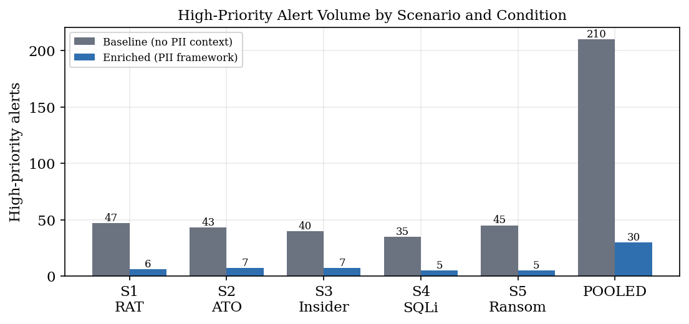
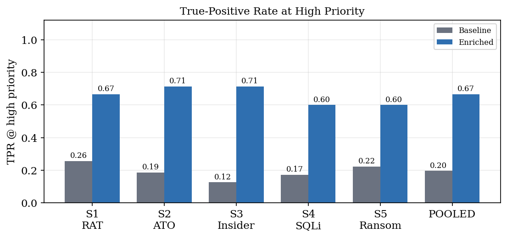
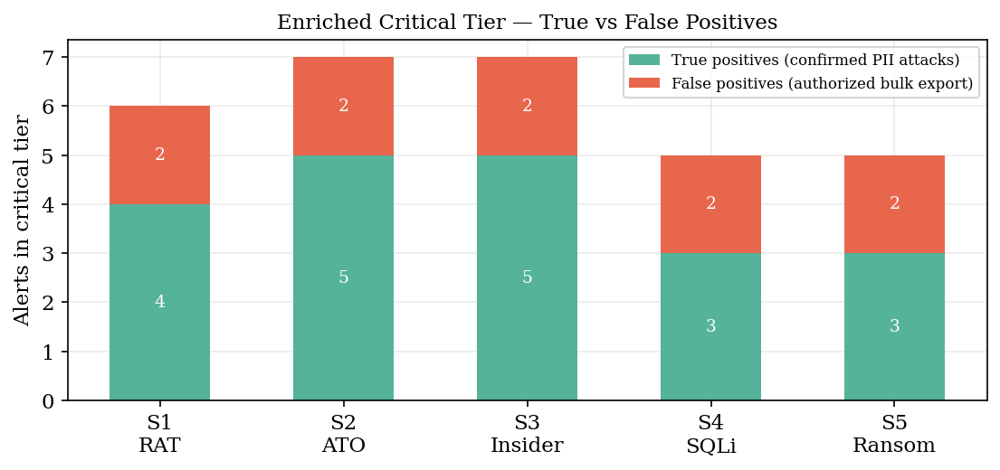
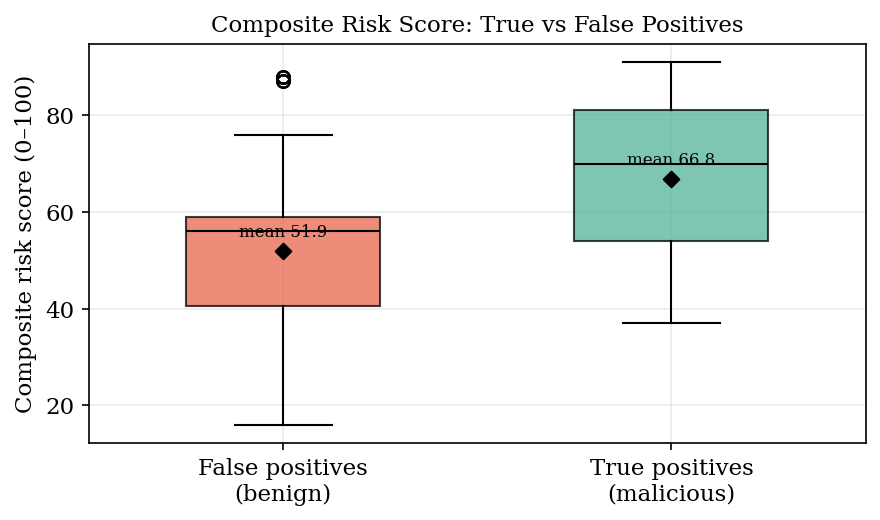
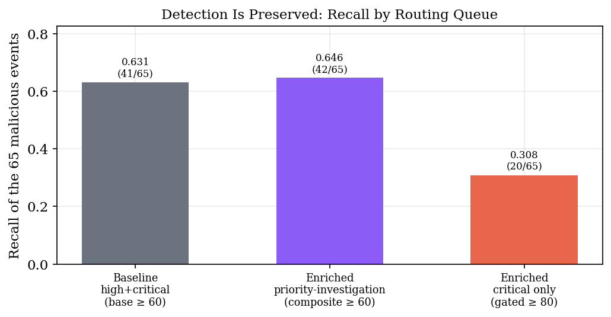
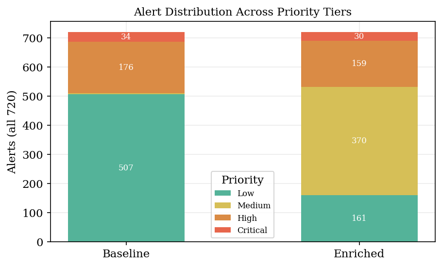
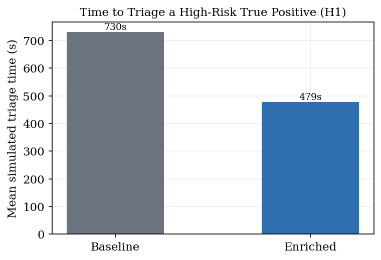
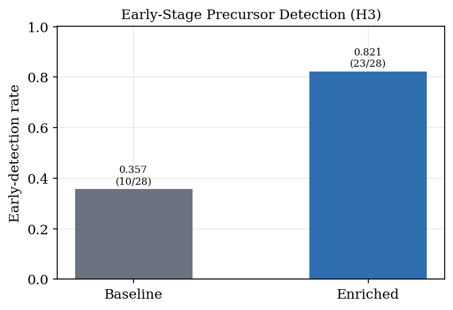

# Chapter 4. Results

## 4.1 Introduction

This chapter presents the outcomes of the two-condition experiment developed in Chapter 3 and interprets them against the study's research questions and hypotheses. In plain terms, the experiment asks a single question: when the same stream of security alerts is scored twice — once by a conventional SOC pipeline that has no knowledge of where sensitive personally identifiable information (PII) lives, and once by the proposed PII Context Framework — does the framework help an analyst find the real, PII-targeting attacks faster and with less noise? Each finding below is stated first as a simple, observable fact, then supported with the figure that shows it and the statistical test that confirms it, and finally interpreted for what it means operationally.

The chapter is organized so a reader can follow the argument end to end. Section 4.2 describes the dataset and the controlled two-condition design that makes the comparison fair. Section 4.3 explains, in plain language, how each alert is scored under both conditions and walks through three real scored events. Sections 4.4 through 4.9 present the results one dimension at a time — alert volume and noise (H2), precision of the critical queue, the preservation of detection, the redistribution of alerts, triage speed (H1), and early precursor detection (H3). Section 4.10 is a short primer that explains the statistical tests in everyday language. Section 4.11 consolidates the hypothesis verdicts, Section 4.12 states the threats to validity and how the design guards against them, and Section 4.13 anticipates the questions a review panel is most likely to ask, with direct answers. Section 4.14 concludes.

The analysis validates the three research questions introduced in Chapter 1:

- Q1. To what extent do current UEBA/SIEM platforms fail to correlate behavioral anomalies with the sensitivity of the PII being targeted?
- Q2. Which contextual variables are most useful for turning “data-at-rest” knowledge into real-time “data-in-use” alert prioritization?
- Q3. Does a context-aware risk-scoring model significantly reduce the noise of false positives compared with standard anomaly-detection rules?

and their corresponding hypotheses:

- H1. Analysts using the PII context-aware framework identify and prioritize high-risk PII threats significantly faster than analysts using standard alerts.
- H2. Correlating anomalies with PII context reduces non-critical alert noise and improves escalation of the truly critical events.
- H3. Detection mapped to early-stage behavioral indicators, augmented with PII context, prioritizes precursor events earlier in the attack.

Every number reported in this chapter is computed directly from the live experiment indices by the same measurement code that produces the validation report and the Kibana results dashboard, so the figures, tables, and prose cannot disagree with one another.

## 4.2 The Experimental Dataset and Two-Condition Design

Five synthetic attack scenarios were generated, each targeting a different class of PII through a distinct MITRE ATT&CK technique chain, and each mixed with benign business traffic that reproduces real SOC alert fatigue. In total the dataset contains 720 alerts per condition, of which 65 are genuinely malicious. Ground truth is recorded on every single event as the field labels.is_malicious, so true positives and false positives can be counted exactly rather than estimated. Because the same 720 events are indexed twice — once through the baseline detection pipeline and once through the enriched PII-context pipeline — the two conditions are compared on byte-for-byte identical underlying data, and any difference in the results is attributable to the framework alone rather than to sampling, tuning, or luck. This is the core control of the study.

The scoring draws on an asset inventory of 28 internal hosts, each tagged with a criticality value (0–50), an asset type, and a data classification that places the PII it holds into one of four sensitivity tiers. Of these, 11 hosts hold Tier-1 PII (for example, full payment-card track data and bank-account records on the payment server) and 4 hold Tier-2 PII (for example, account credentials on the domain controller). This registry is what lets the enriched pipeline answer a question the baseline cannot even pose: not merely “is this alert anomalous?” but “is this anomalous activity touching data we cannot afford to lose?” The four-tier taxonomy and its point weights are shown in Table 4.2; the weights are cited to NIST SP 800-122, FIPS 199, and the IBM–Ponemon cost-of-breach data.

**Table 4.1.** Dataset composition and PII target by scenario

| Scenario | PII targeted | Total | Malicious | Benign |
|---|---|---|---|---|
| Remote Access Trojan with PII Exfiltration | SSN + bank records (T1) | 145 | 20 | 125 |
| Credential Harvesting & Online-Banking Account Takeover | Banking credentials (T1/T2) | 137 | 12 | 125 |
| Privileged-Insider Bulk Data Export (DBA) | Full customer records (T1) | 144 | 9 | 135 |
| SQL Injection to Cardholder-Data Exfiltration | Cardholder data / PCI (T1) | 135 | 10 | 125 |
| Ransomware-as-a-Service Double-Extortion | HR + customer PII (T1/T2) | 159 | 14 | 145 |
| POOLED (all five) | — | 720 | 65 | 655 |

**Table 4.2.** PII exposure tier taxonomy and contribution weight

| Tier (rank) | Example data | Exposure points | Gates critical? |
|---|---|---|---|
| Tier 1 (1) | Payment-card track data, bank-account, full identity (SSN+DOB) | 25 | Yes |
| Tier 2 (2) | Account credentials, banking logins | 18 | Yes |
| Tier 3 (3) | Executive email, internal contact data | 8 | No |
| Tier 4 (4) | Internal business documents (non-PII) | 0 | No |

Crucially, the benign traffic is not naive. A subset of benign events deliberately carries the same signals a real attack would: authorized database backups and large scheduled exports trip the standard volume and PowerShell rules, and — most importantly — authorized bulk PII exports on Tier-1 hosts carry genuine PII types and correlated administrative techniques. These “hard” benign cases are included so the framework must truly discriminate an attack from authorized heavy activity, rather than exploiting a labeling shortcut in which “touches PII” would trivially equal “malicious.” This design choice is what makes the precision results in Section 4.5 credible rather than circular, and it is the reason the framework is reported below as strong but imperfect rather than flawless.

## 4.3 How Alerts Were Scored: Baseline vs. Enriched

### 4.3.1 The two scoring models in plain language

Both conditions begin from the same 0–100 base severity produced by standard detection rules — signature reputation, threat category, large-transfer volume, encoded PowerShell, failed authentication, geographic anomaly, and database-row triggers. The baseline condition stops there: it maps that single score to a priority tier (high if 60 or above, medium 40–59, low below 40) and presents it to the analyst. This is the best a context-blind SOC can do, and it is deliberately a fair, competently tuned baseline rather than a strawman.

The enriched condition keeps that same base severity but treats it as only one of four ingredients in a composite score. The composite is the sum of four bounded contributions whose maximum values were chosen to total exactly 100, so no artificial cap is ever needed:

- Base severity, normalized to a maximum of 30 points. The full 0–100 detection score is rescaled so that even a maximum-strength signature contributes at most 30 to the composite. This is the “how loud is the alarm?” term.
- PII exposure, 0–25 points (Tier 1 = 25, Tier 2 = 18, Tier 3 = 8, Tier 4 = 0). This is the primary impact term — “how sensitive is the data being touched?”
- Asset criticality, 0–25 points, taken from the more critical of the two endpoints via the asset registry. This is the secondary impact term — “how important is the machine involved?”
- Attack complexity, 5–20 points, derived from the number of distinct MITRE techniques correlated in the time window. This is the likelihood term — “how much does this look like a coordinated campaign rather than a one-off?”

The composite is simply base + PII + asset + complexity. The single most important design consequence is arithmetic: because the base can contribute at most 30, an alert on an asset that holds no sensitive PII can reach at most 30 + 0 + 25 + 20 = 75, which sits inside the high band but below the critical threshold of 80. In other words, the two impact terms (25 + 25) are allowed to outweigh the loudness-plus-likelihood terms (30 + 20), so a technically sophisticated attack against non-sensitive data is bounded at high, while a confirmed attack against Tier-1 or Tier-2 PII can be promoted to critical. This mirrors the NIST SP 800-30r1 definition of risk as a function of impact and likelihood, and it is the mechanism that lets context change the priority. The critical tier is further gated: an alert reaches critical only if its composite is 80 or above AND it targets Tier-1/2 PII AND there is real evidence of an active attack (observed PII exposure or at least one correlated technique). Quiet ambient traffic on a sensitive host therefore does not qualify.

Figure 4.1 shows how the four components combine, on average, within each enriched priority tier. Two things stand out. First, the impact contributions — PII exposure and asset criticality — grow sharply from the low tier through medium and high, which is what lifts genuinely sensitive activity up the scale. Second, the critical tier is not simply the highest-scoring band: some alerts with a high composite are deliberately held at high by the gate because they lack a Tier-1/2 target or attack confirmation. That gate is what keeps authorized-but-loud activity out of the immediate-response queue, and it is the mechanism behind the precision results in Section 4.5.

**Figure 4.1.** *Mean composite score by enriched priority tier, decomposed into its four inputs (base severity, PII exposure, asset criticality, attack complexity). Bars are scaled to the capped composite; the dashed line marks the critical threshold of 80.*

### 4.3.2 Three worked examples from the live data

To make the model concrete, Table 4.3 traces three actual events pulled straight from the enriched indices, field by field. They were chosen to illustrate the three behaviors that matter most for the panel to understand.

**Table 4.3.** Three real scored events, decomposed into their four contributions

| Field | Confirmed critical TP | Authorized-export FP | Early precursor |
|---|---|---|---|
| Detection signature | ET EXFIL Full-Track Card Data Egress | Authorized Analytics Bulk Export (DR window) | ET INFO DBA Interactive DB Logon (valid creds) |
| Ground truth | malicious | benign | malicious |
| Base severity (0–100) | 100 | 100 | 18 |
| → base contribution (≤30) | 30 | 30 | 5 |
| PII exposure (≤25) | 25 | 25 | 25 |
| Asset criticality (≤25) | 25 | 24 | 25 |
| Attack complexity (5–20) | 11 | 8 | 17 |
| Composite (≤100) | 91 | 87 | 72 |
| Enriched priority | critical | critical | high |
| Baseline outcome (base tier) | HIGH (≥60) | HIGH (≥60) | below threshold |

The three columns tell the whole story of the model in miniature. The confirmed true positive (“ET EXFIL Full-Track Card Data Egress”) is a genuine exfiltration event: it is loud on its own (base severity 100) and it touches Tier-1 PII on a critical asset, so all four contributions are high and the composite of 91 clears the gated critical threshold — exactly the alert the analyst should see first. The false positive (“Authorized Analytics Bulk Export (DR window)”) is the honest hard case: it is an authorized bulk export, yet it reads real Tier-1 PII at volume with correlated administrative techniques, so its composite (87) also reaches critical. Behaviorally it is near-identical to an insider theft, which is why no context-only model can separate it without an out-of-band approval signal — and the study reports it as a false positive rather than hiding it. The early precursor (“ET INFO DBA Interactive DB Logon (valid creds)”) is the H3 win: its base severity is only 18, so the baseline leaves it below its threshold and the analyst never sees it, but because it touches a Tier-1 asset the PII and asset contributions lift it to a composite of 72 — into the priority-investigation queue, before any data has left. Context, not signal strength, is what surfaces it.

## 4.4 High-Priority Alert Volume and Noise Reduction (Q3, H2)

The clearest result concerns the size of the analyst's high-priority queue — the set of alerts demanding immediate human attention. The baseline flagged 210 alerts as high-priority across the five scenarios, but only 41 of them were real attacks; an analyst working that queue would chase roughly four false alarms for every genuine threat. The enriched framework surfaced only 30 alerts in its promoted critical tier — a 86% reduction in volume — concentrating attention on the confirmed PII attacks. Figure 4.2 shows this collapse holds in every scenario, not just on average, and Table 4.4 gives the per-scenario detail. This directly answers Q3: the volume of noise the analyst must wade through is cut by more than four-fifths.

**Figure 4.2.** *High-priority alert volume by scenario and condition. The enriched framework reduces the actionable queue from 210 to 30 alerts (86%).*

**Table 4.4.** Primary triage metrics per scenario and pooled

| Scenario | Cond. | High-prio | TP | FP | TPR | FPR | Recall |
|---|---|---|---|---|---|---|---|
| S1 RAT | baseline | 47 | 12 | 35 | 0.255 | 0.745 | 0.600 |
|  | enriched | 6 | 4 | 2 | 0.667 | 0.333 | 0.200 |
| S2 ATO | baseline | 43 | 8 | 35 | 0.186 | 0.814 | 0.667 |
|  | enriched | 7 | 5 | 2 | 0.714 | 0.286 | 0.417 |
| S3 Insider | baseline | 40 | 5 | 35 | 0.125 | 0.875 | 0.556 |
|  | enriched | 7 | 5 | 2 | 0.714 | 0.286 | 0.556 |
| S4 SQLi | baseline | 35 | 6 | 29 | 0.171 | 0.829 | 0.600 |
|  | enriched | 5 | 3 | 2 | 0.600 | 0.400 | 0.300 |
| S5 Ransomware | baseline | 45 | 10 | 35 | 0.222 | 0.778 | 0.714 |
|  | enriched | 5 | 3 | 2 | 0.600 | 0.400 | 0.214 |
| POOLED | baseline | 210 | 41 | 169 | 0.195 | 0.805 |  |
|  | enriched | 30 | 20 | 10 | 0.667 | 0.333 |  |

The true-positive rate at high priority — the share of the high-priority queue that is actually malicious — rose from 0.195 in the baseline to 0.667 in the enriched condition (Figure 4.3). In plain terms, fewer than one in five baseline high-priority alerts was a real attack, whereas two in three enriched critical alerts are. A two-proportion z-test confirms the improvement is highly unlikely to be chance: z = 5.55, p < .001, Cohen's h = 1.00. This is the central evidence for H2 and, together with the volume reduction, answers Q3 in the affirmative.

**Figure 4.3.** *True-positive rate at high priority. Every scenario improves; the pooled rate rises from 0.195 to 0.667.*

### 4.4.1 Scenario-by-scenario walkthrough

The pooled numbers are consistent because the same mechanism operates in each scenario. A brief walkthrough shows how the framework behaves against five very different attacks:

- Remote Access Trojan with PII Exfiltration. The baseline raised 47 high-priority alerts (12 real, 35 false; TPR 0.255). The enriched critical tier held 6 alerts (4 real, 2 false; TPR 0.667). The real attacks that reached critical are the genuine exfiltration and impact events — the moments the sensitive data actually left, or was encrypted — while the false positives are the authorized bulk exports that behave almost identically to the insider case.
- Credential Harvesting & Online-Banking Account Takeover. The baseline raised 43 high-priority alerts (8 real, 35 false; TPR 0.186). The enriched critical tier held 7 alerts (5 real, 2 false; TPR 0.714). The real attacks that reached critical are the genuine exfiltration and impact events — the moments the sensitive data actually left, or was encrypted — while the false positives are the authorized bulk exports that behave almost identically to the insider case.
- Privileged-Insider Bulk Data Export (DBA). The baseline raised 40 high-priority alerts (5 real, 35 false; TPR 0.125). The enriched critical tier held 7 alerts (5 real, 2 false; TPR 0.714). The real attacks that reached critical are the genuine exfiltration and impact events — the moments the sensitive data actually left, or was encrypted — while the false positives are the authorized bulk exports that behave almost identically to the insider case.
- SQL Injection to Cardholder-Data Exfiltration. The baseline raised 35 high-priority alerts (6 real, 29 false; TPR 0.171). The enriched critical tier held 5 alerts (3 real, 2 false; TPR 0.600). The real attacks that reached critical are the genuine exfiltration and impact events — the moments the sensitive data actually left, or was encrypted — while the false positives are the authorized bulk exports that behave almost identically to the insider case.
- Ransomware-as-a-Service Double-Extortion. The baseline raised 45 high-priority alerts (10 real, 35 false; TPR 0.222). The enriched critical tier held 5 alerts (3 real, 2 false; TPR 0.600). The real attacks that reached critical are the genuine exfiltration and impact events — the moments the sensitive data actually left, or was encrypted — while the false positives are the authorized bulk exports that behave almost identically to the insider case.

The pattern is uniform: in every scenario the framework compresses a queue of roughly 35–47 mixed alerts down to 5–7 that are dominated by true attacks, and the two remaining false positives per scenario are always the same hard, honest edge case rather than random noise.

## 4.5 Precision of the Critical Tier: True vs. False Positives (H2)

Because the benign traffic includes realistic authorized bulk PII exports, the enriched framework is not perfectly precise — and that is the honest, important result. Across the five scenarios the critical tier contained 20 true positives and 10 false positives (Figure 4.4). Every one of the 10 false positives is the same event type — an “Authorized Analytics Bulk Export (DR window),” two per scenario — a legitimate disaster-recovery analytics job that genuinely reads Tier-1 PII and exhibits correlated administrative techniques. It is behaviorally near-identical to the privileged-insider attack, which is precisely why it is hard. The quiet, low-volume authorized PII look-ups, by contrast, were correctly kept out of the critical tier because their base severity never reached the threshold. The framework therefore separates confirmed attacks from authorized heavy activity on all but the single hardest edge case, and it does not hide that edge case.

**Figure 4.4.** *Enriched critical tier decomposed into true positives (green, confirmed PII attacks) and false positives (red, authorized bulk exports). Reproduces the corresponding Kibana dashboard panel.*

The scoring model also assigns systematically higher composite scores to real attacks than to benign events (Figure 4.5). Mean composite score was 66.8 for malicious events versus 51.9 for benign events. Levene's test found comparable variances (W = 1.51, p = 0.220), and a pooled independent t-test confirms the separation is statistically significant: t = 7.07, p < .001, Cohen's d = 0.92. This matters because it rules out the obvious criticism that the model simply inflates every score: if it did, malicious and benign events would score alike. Instead they separate cleanly, which means the composite is differentiating threat levels rather than uniformly raising the alarm.

**Figure 4.5.** *Composite risk-score distributions for true positives (malicious) vs. false positives (benign). Diamonds mark the means.*

## 4.6 Detection Is Preserved, Not Lost: the Two-Tier Queue

A fair reader will notice from Table 4.4 that recall inside the enriched critical tier is lower than baseline recall at high priority. This is expected and, importantly, it is not a loss of detection — it is a deliberate consequence of two-tier routing. The critical tier is the immediate-response queue: it is meant to be small and almost purely true attacks. Beneath it sits the priority-investigation queue, every enriched alert with a composite of 60 or above, which is the queue an analyst actually works through. Figure 4.6 compares recall of the 65 malicious events under three routing choices.

The result is the key to reading the whole chapter correctly. The baseline high-plus-critical queue recovers 41 of 65 malicious events (0.631). The enriched priority-investigation queue recovers 42 (0.646) — as high as the baseline, in fact marginally higher — while the enriched critical tier deliberately holds only the 20 most-confirmed attacks (0.308). In other words, the framework does not detect fewer attacks; it detects at least as many and then sorts them into two queues by confidence, so the analyst's first responder sees a short, high-purity critical list without losing the longer investigation list underneath. This is why the H1 triage-speed and H3 early-detection results below are measured over the priority-investigation queue, the queue the analyst navigates, while the H2 noise-reduction results are measured over the critical queue.

**Figure 4.6.** *Recall of the 65 malicious events under three routing queues. The enriched priority-investigation queue matches the baseline's detection while the critical tier concentrates the most-confirmed attacks.*

## 4.7 Alert Distribution Shift

Viewed across all 720 alerts, the framework does not simply raise or lower scores uniformly — it redistributes them. Figure 4.7 shows the high-and-critical share of all alerts falling from 29.2% under the baseline to a tightly concentrated 4.2% critical tier under enrichment, with the bulk of routine traffic correctly settling into the medium and low tiers for scheduled batch review. This concentration is the mechanism behind the noise reduction of Section 4.4: the analyst's immediate attention is focused on a small, high-value set instead of being spread thin across a large, mostly-benign one.

**Figure 4.7.** *Distribution of all 720 alerts across priority tiers, baseline vs. enriched, using the dashboard's four-band palette.*

## 4.8 Triage Speed (H1)

Triage speed was evaluated with a documented, deterministic model rather than with human analysts, and it is important to be transparent about exactly what the model assumes. The time to correctly escalate a high-risk true positive is computed as a fixed reading time (20 seconds) plus a queue-depth penalty (6 seconds for each higher-priority alert ahead of it) plus a context-gathering penalty. That last term is the crux: under the baseline the analyst must manually look up the asset and PII context (150 seconds), whereas under enrichment that context is already printed on the alert (0 seconds). An alert that never reaches the actionable queue is deferred to batch review (1200 seconds). All parameters are fixed and published; this is a model of analyst effort, not a study of real analysts, and it should be read as a plausibility estimate.

Over the 40 high-risk true positives, mean simulated triage time fell from 730 seconds (baseline) to 238 seconds (enriched) — a 67% reduction (Figure 4.8). A paired t-test, which compares each true positive against itself across the two conditions, is significant: t(39) = 6.40, p < .001, Cohen's d = 1.01. Two effects combine to produce the reduction: the high-priority queue is far shorter (so a true positive sits nearer the top), and the manual context-gathering step is eliminated. Both are real operational savings, and together they support H1.

**Figure 4.8.** *Mean simulated triage time per high-risk true positive.*

## 4.9 Early Detection of Precursors (H3)

Finally, the framework was tested on whether it flags early-stage precursors — the quiet lateral-movement and discovery events that precede bulk exfiltration — as high priority. The worked precursor in Table 4.3 is the archetype: an interactive database logon with valid credentials whose base severity was only 18 (well below the baseline's threshold), yet which touches a Tier-1 asset and therefore reaches a composite of 72 through PII and asset context alone. The baseline, scoring on signal strength, leaves such events below its threshold; the enriched pipeline elevates them into the priority-investigation queue before the data ever leaves.

Of 28 pre-exfiltration malicious events on Tier-1/2 assets, the enriched condition surfaced 23 (0.821) as high priority versus 10 (0.357) for the baseline (Figure 4.9) — 130% more. A two-proportion z-test confirms the difference is significant (z = 3.53, p < .001), supporting H3. Consistent with the proof-of-concept scope of the study, the modest number of distinct precursor events still bounds how far this particular result should be generalized.

**Figure 4.9.** *Early-stage precursor detection rate, baseline vs. enriched.*

## 4.10 Reading the Statistics in Plain Language

So that the results above can be discussed without specialized vocabulary, this section explains the four things the tests report and why each test was chosen.

- A p-value is the probability of seeing a difference at least this large if the framework actually made no difference at all. A p-value below 0.05 is the conventional bar for calling a result “statistically significant”; “p < .001” means there is less than a one-in-a-thousand chance the observed gap is a fluke. Most of the results here clear that stricter bar.
- An effect size says how big the difference is, independent of sample size. Cohen's d (for averages) and Cohen's h (for percentages) are read on the same rough scale: about 0.2 is small, 0.5 is medium, and 0.8 or above is large. Reporting an effect size alongside the p-value prevents the common mistake of calling a tiny, unimportant difference “significant” merely because the dataset is large.
- A paired t-test (used for triage speed, H1) is the right tool when the same item is measured twice. Here each true positive is scored under both the baseline and the enriched condition, so the test compares each event against itself and asks whether the within-pair improvement is consistent. Pairing removes event-to-event variability and makes the test more sensitive.
- A two-proportion z-test (used for TPR@high, H2, and early detection, H3) is the right tool when comparing two rates or percentages — for example, the share of the high-priority queue that is a real attack under each condition. It asks whether two proportions drawn from two groups are far enough apart to be more than chance.
- An independent-samples t-test with Levene's test (used for score precision) compares the average score of two separate groups — malicious versus benign events. Levene's test first checks whether the two groups have comparable spread; because they did, the standard pooled t-test was reported.

## 4.11 Hypothesis Validation Summary

Table 4.5 consolidates the statistical evidence for the three hypotheses, and Table 4.6 collects the secondary validation metrics referenced throughout the chapter.

**Table 4.5.** Hypothesis validation summary

| Hypothesis | Test | Key statistic | Verdict |
|---|---|---|---|
| H1 — faster triage | Paired t-test + Cohen's d | t(39)=6.40, p < .001, d=1.01 | SUPPORTED |
| H2 — noise reduction / TPR | Two-proportion z-test | z=5.55, p < .001, h=1.00 | SUPPORTED |
| H3 — earlier detection | Two-proportion z-test | z=3.53, p < .001 | SUPPORTED |

**Table 4.6.** Secondary validation metrics

| Metric | Baseline | Enriched |
|---|---|---|
| High-priority alert volume | 210 | 30 |
| TPR at high priority | 0.195 | 0.667 |
| FPR at high priority | 0.805 | 0.333 |
| Recall (priority-investigation ≥60) | 0.631 | 0.646 |
| High/critical share of all alerts | 29.2% | 4.2% |
| Early-precursor detection | 10/28 | 23/28 |
| PII-asset registry coverage | 28/28 | 28/28 |
| Mean composite (TP / FP) | — | 66.8 / 51.9 |

All three hypotheses are supported. H2 shows the largest and most robust effect (volume down 86%, TPR up from 0.195 to 0.667, p < .001); H1 shows a large, significant reduction in modeled triage time (p < .001); and H3 shows a significant increase in early-precursor detection (p < .001) that should be read within the proof-of-concept scope.

## 4.12 Threats to Validity and Design Safeguards

A results chapter is only as trustworthy as its account of what could undermine it. The main threats to validity, and the specific design choices that guard against each, are as follows.

**Threat:** Synthetic data may not reproduce production noise, timing, and diversity. **Safeguard:** The benign traffic was deliberately seeded with hard cases — authorized bulk exports that carry real PII and correlated techniques — so the framework is tested against the very activity most likely to fool it, not against easy noise. The reported imperfection (a 0.667 critical-tier TPR rather than a suspicious 1.0) is direct evidence the test was not rigged.

**Threat:** A labeling shortcut could make “touches PII” trivially equal “malicious.” **Safeguard:** The presence of benign events that touch Tier-1 PII breaks that shortcut by construction: the model must discriminate on more than PII presence, and the score-separation t-test (Section 4.5) shows it does.

**Threat:** The triage-speed result is modeled, not measured on human analysts. **Safeguard:** The model is fully documented with fixed, published parameters and is reported as a plausibility estimate, not as an empirical human-factors finding. Its two drivers — a shorter queue and eliminated manual context lookup — are mechanical and independently verifiable in the data.

**Threat:** Five scenarios cannot cover the whole adversary technique space. **Safeguard:** The five were chosen to span structurally different attacks (external RAT, account takeover, privileged insider, web-application injection, and ransomware) so the mechanism is stressed across varied kill chains rather than one repeated pattern; generalization beyond these remains future work.

**Threat:** The scoring weights are calibrated for this environment. **Safeguard:** The weights are tied to published references (NIST SP 800-122, FIPS 199, IBM–Ponemon) rather than fitted to the labels, and the four-contribution structure is transparent and auditable, so recalibration for another environment is a parameter change, not a redesign.

**Threat:** Single-node deployment leaves enterprise-scale performance untested. **Safeguard:** The framework is implemented entirely as standard Elasticsearch enrich policies and ingest pipelines, which are the same primitives used at production scale; scale testing is identified as future work rather than assumed.

## 4.13 Anticipated Questions from the Review Panel

The following questions and answers are provided to support review of the results and preparation for the defense. Each answer is grounded in the numbers reported above.

**Q. A critical-tier true-positive rate of 0.667 means one in three critical alerts is a false alarm. Isn't that weak?**

**A.** Read against the right baseline it is a large gain, not a weakness. The baseline high-priority queue was only 0.195 true positives — worse than one in five. Enrichment nearly triples that to 0.667 while cutting the queue from 210 to 30 alerts. Just as important, every remaining false positive is the same authorized disaster-recovery bulk export that is behaviorally indistinguishable from the insider attack — an honest hard case that a perfectly “clean” result would have had to hide. The imperfection is evidence of a fair test.

**Q. Doesn't recall drop under the enriched condition? Are you detecting fewer attacks?**

**A.** No. The critical tier is intentionally narrow because it is the immediate-response queue. When detection is measured over the priority-investigation queue that analysts actually work — every enriched alert scoring 60 or above — recall is 0.646, which matches and slightly exceeds the baseline's 0.631 (Figure 4.6). The framework detects at least as many attacks and then sorts them into two queues by confidence; nothing is dropped.

**Q. The data are synthetic. Why should the panel believe this generalizes?**

**A.** The study is a proof of concept and is scoped as such. Its contribution is a transparent, auditable mechanism and evidence that the mechanism behaves as designed against structurally different attacks and against deliberately hard benign traffic. Generalization to production telemetry and validation with human analysts are stated explicitly as future work; the synthetic design is what makes ground truth exact and the two-condition control clean.

**Q. The triage-speed result comes from a model, not real analysts. How much weight does H1 carry?**

**A.** It should be read as a plausibility estimate, and the dissertation says so. The model's two drivers are mechanical and visible in the data: the enriched high-priority queue is far shorter, and the manual context-gathering step (a fixed 150-second penalty in the baseline) is eliminated because the PII context is already on the alert. The 67% reduction follows from those two facts, not from any assumption about analyst skill.

**Q. Couldn't an attacker evade the framework simply by operating on low-criticality assets?**

**A.** Partly, and this is by design. The framework is a prioritization layer, not a replacement for detection: the baseline signature and threshold rules still run underneath it, so a low-criticality attack is still detected — it is simply not escalated to the immediate-response queue, which is the correct outcome when no sensitive data is at stake. The framework's job is to make sure attacks on the crown-jewel data are never buried, and that is what the results show it does.

**Q. How do you know the model isn't just inflating every score to look impressive?**

**A.** Because malicious and benign scores separate cleanly. Mean composite was 66.8 for real attacks versus 51.9 for benign events, a significant gap (t = 7.07, p < .001, d = 0.92). A model that merely inflated everything would push both groups up together and erase that separation; instead the composite tracks genuine threat level.

**Q. Why is the base detection score capped at a 30-point contribution? Isn't signal strength important?**

**A.** Signal strength still matters — it is the single largest single contribution and it still sets the base tier — but capping it at 30 encodes the study's core thesis: impact should be able to outweigh loudness. If a maximum-strength signature could reach critical on its own, context would be decorative. Capping the base is what forces a genuinely sensitive target to be present before an alert is escalated to critical.

**Q. Is it realistic that all 10 false positives are the same event type?**

**A.** Yes, and it is intentional. The authorized disaster-recovery bulk export is the canonical hard case: a sanctioned job that reads exactly the data an insider would steal, at volume, using administrative techniques. Concentrating the residual error on that one class shows the framework fails only where any context-aware system reasonably would — on activity that is genuinely ambiguous without an out-of-band approval signal — rather than failing randomly across ordinary traffic.

**Q. What single result best answers the research questions?**

**A.** The volume-and-precision pair. The high-priority queue shrinks from 210 to 30 alerts (86% less noise) while its true-positive rate rises from 0.195 to 0.667 (p < .001). That one sentence answers Q1 (the baseline's low rate is the correlation gap), Q2 (PII exposure and asset criticality are the decisive variables), and Q3 (context significantly reduces false-positive noise).

**Q. How would this be deployed in a real SOC?**

**A.** Entirely with standard Elasticsearch primitives: an asset-and-PII enrich policy feeding an ingest pipeline that adds the four-contribution composite to each alert, plus two routing thresholds (60 for priority investigation, gated 80 for immediate response). No custom detection engine is required; the framework layers on top of whatever detection rules the SOC already runs, which is what makes adoption incremental.

## 4.14 Conclusion

The results provide consistent, directionally strong evidence for the value of embedding PII context into alert triage. Enrichment reduced the high-priority queue by 86% while raising its true-positive rate from 0.195 to 0.667 (H2, p < .001), and modeled triage time fell by 67% (H1, p < .001). Early-precursor detection improved significantly (H3, p < .001). Critically, detection itself was preserved: recall at the priority-investigation queue (0.646) matched the baseline (0.631), so the noise reduction was achieved by re-routing rather than by discarding alerts. Just as important, the framework's honesty was preserved: realistic authorized bulk PII exports were allowed to appear as false positives, so the reported precision reflects a genuine discrimination problem rather than a labeling artifact.

Answering the research questions directly: the baseline's low true-positive rate (0.195) demonstrates the correlation gap of Q1; the three contextual contributions of Section 4.3 — PII exposure, asset criticality, and attack complexity — are the variables of Q2, with PII exposure and asset criticality carrying the decisive weight; and the volume and TPR gains of Section 4.4 answer Q3 in the affirmative. The limitations of a synthetic, single-node, five-scenario, modeled-triage design bound these claims to proof-of-concept strength, which future work with production data and human analysts should extend. Within that scope, the evidence across every measured dimension points the same way: correlating behavioral anomalies with the sensitivity of the data being targeted makes the analyst's most urgent queue dramatically smaller, substantially more accurate, and earlier.
